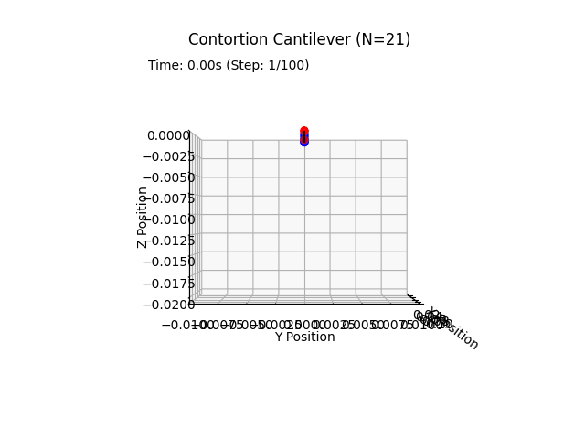
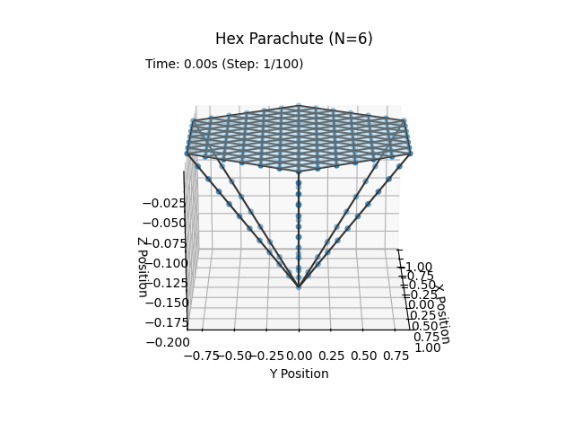
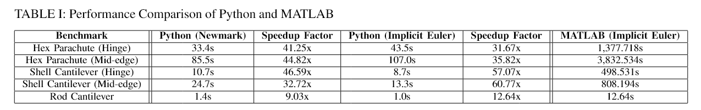

# dismech-python
|  |  |
|:--:|:--:|
| Straight contortion of 3D discrete rod. |  Hex parachute falling with drag. |
| Energy-conserving Newmark-beta ($\gamma=0.5$ $\beta=0.25$) integration. |  Energy-conserving implicit midpoint integration. |


A discrete differential geometry based soft robot and deformable structure simulator.

## Setup

We recommend using [uv](https://docs.astral.sh/uv/) to setup this package.

```bash
git clone https://github.com/StructuresComp/dismech-python.git
cd dismech-python
uv pip install -e . # uv sync --extra pardiso for sparse solving
```

## Features

- [x] 3D [discrete elastic rod](https://www.cs.columbia.edu/cg/pdfs/143-rods.pdf) stretching, bending and twisting.
- [x] 3D discrete elastic shell hinge and mid-edge bending.
- [x] Pytest numerical validation suite.
- [x] Implicit integration schemes (Euler and Newmark-beta).
- [x] Dense and sparse ([PyPardiso](https://pypi.org/project/pypardiso/)) solvers.
- [x] Significant speedup for dynamic simulations.
- [x] [IMC](https://arxiv.org/abs/2205.10309) rod contact and friction modeling.
- [x] Shell contact and friction modeling.

<!--  -->

## Experiments

To run example experiments, please run the python notebooks located in experiments. They rely on local paths to tests/resources, so they will break if moved.

## TODO

- [ ] Sphinx documentation.
- [ ] Slinky NN demonstration.
